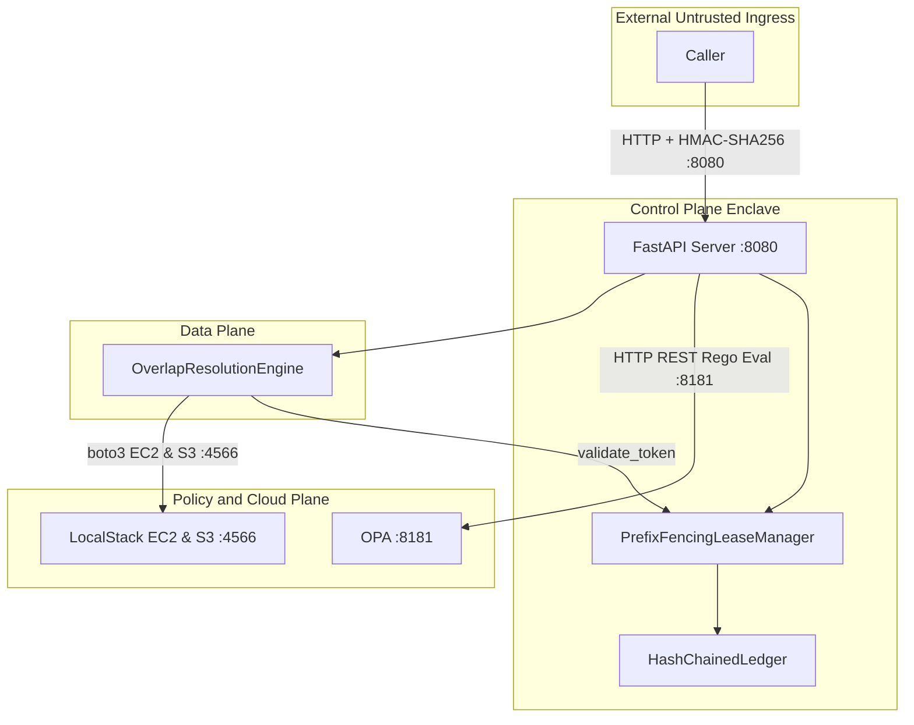
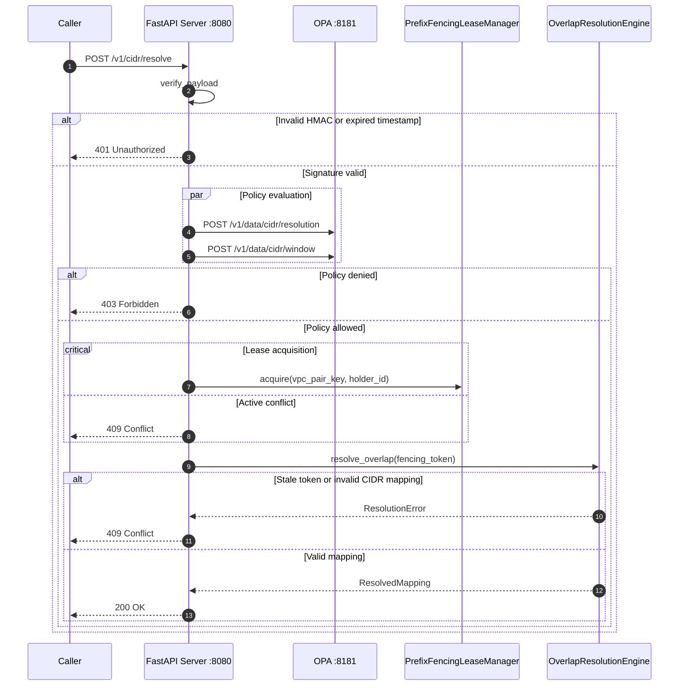
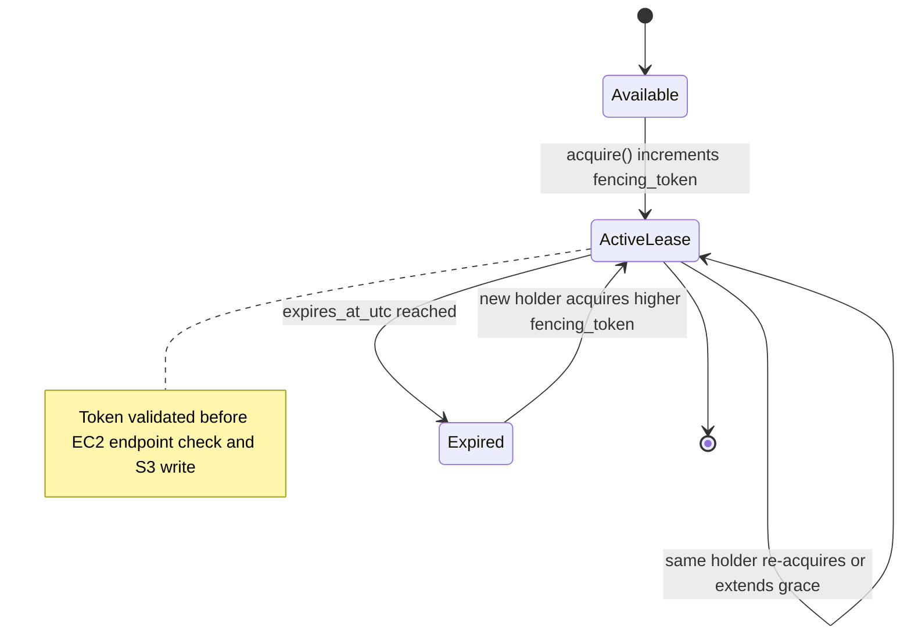
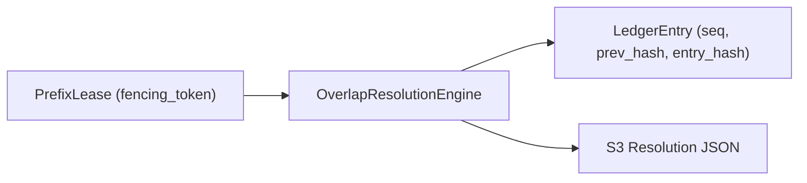

# Design Notes: Overlapping CIDR Resolution with NAT and PrivateLink

This service separates lease management and hash-chained audit logging (`controlplane/ipam_lease.py`, `controlplane/server.py`, `storage/audit_ledger.py`) from CIDR overlap validation and AWS EC2/S3 recording (`dataplane/resolver.py`) with Open Policy Agent (OPA) policy enforcement.

## Trust-Boundary and Network Enclave Topology

## Distributed Concurrency and Resolution Sequence

## Prefix Lease State Machine

## Resolution and Ledger Data Flow

## Trade-Offs and Limitations

Lease TTLs and UTC change windows use UTC timestamps so Daylight Saving Time transitions do not alter cutoffs. Off-window resolutions support up to a 15-minute grace extension with a valid incident ID. AWS requests retry transient throttling and HTTP `429`/`502`/`503`/`504` responses up to 4 times with per-attempt sleep capped at `2.0s`.

Limitations: `PrefixFencingLeaseManager` and `HashChainedLedger` are held in single-process memory rather than a shared database, and `describe_vpc_endpoints` does not paginate across `NextToken`.
