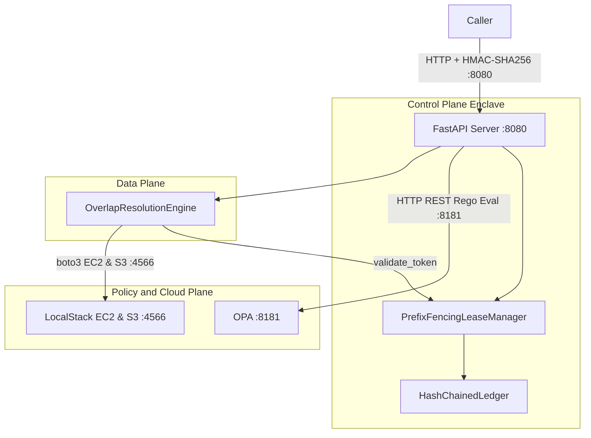

# cidr-overlap-nat-privatelink

Python FastAPI control plane and resolver for overlapping VPC CIDRs using NAT translation (`nat_1to1`) or AWS PrivateLink (`privatelink_endpoint`), backed by monotonic fencing tokens, SHA-256 hash-chained audit entries, OPA policies, and AWS EC2/S3 calls.



## Prerequisites

- Python 3.10+
- Docker and Docker Compose
- `curl` and `openssl`

## Local Setup

Start LocalStack (`ec2,s3`) and OPA:

```bash
make up
```

Run the control plane:

```bash
make run
```

Run tests, chaos test, and benchmark:

```bash
make test
make chaos
make bench
```

Stop containers:

```bash
make down
```

## Sample Request

```bash
BODY='{"source_vpc":"vpc-a","target_vpc":"vpc-b","source_cidr":"10.10.0.0/16","target_cidr":"10.10.0.0/16","translated_cidr":"100.64.10.0/16","strategy":"privatelink_endpoint","holder_id":"resolver-1","actor_role":"net-architect"}'
TS=$(date -u +%s)
SIG="sha256=$(printf '%s.%s' "$TS" "$BODY" | openssl dgst -sha256 -hmac 'local-dev-cidr-secret' | awk '{print $2}')"

curl -s -X POST http://localhost:8080/v1/cidr/resolve   -H "Content-Type: application/json"   -H "X-Timestamp: $TS"   -H "X-Signature-256: $SIG"   -d "$BODY"
```

## Measured Output

From running `python3 -m unittest discover -s tests -p "test_*.py" -v`:

- `Ran 5 tests in 0.080s` (`OK`).
- `BENCH lease+validate+ledger (2000 ops): 56.72 ms (28.36 us/op)`.

## Known Limitations

- In-memory `PrefixFencingLeaseManager` and `HashChainedLedger` are per-process rather than backed by a shared database.
- Single AWS region per process (`AWS_REGION`).
- `describe_vpc_endpoints` reads the first response page without `NextToken` pagination.
